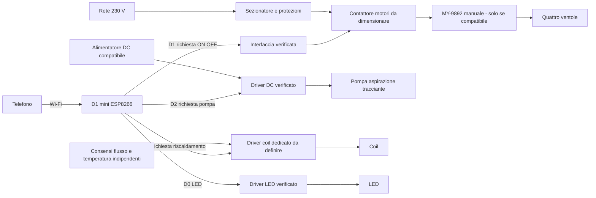

# VENTO — bozza con MY-9892, relè e MOSFET

[Apri il disegno aggiornato del circuito](../schemi/circuito-regolazione-manuale.svg).

[Apri lo schema ESP32, relè e contattore](../schemi/esp32-rele-contattore.svg).

Questa bozza descrive le funzioni. Non è uno schema di cablaggio e non identifica ancora i morsetti di potenza. Non alimentare sulla base del disegno.

## Componenti identificati nella foto

- **Scheda rossa:** due relè SONGLE SRD-05VDC-SL-C, con bobine a 5 V. Ogni relè ha contatti di scambio. La scheda riporta High/Low Level Trigger e due ponticelli. Non conosciamo ancora soglia di ingresso, corrente richiesta, corretto stato ai reset e isolamento reale. Il valore 10 A stampato sul relè non garantisce l'idoneità per quattro motori, le loro correnti di spunto o l'intera scheda.
- **Scheda blu:** identificata dall’utente come XY-MOS; modulo con due transistor di potenza marcati Q1 e Q2, una spia e quattro morsetti. Sembra un modulo MOSFET; non è possibile stabilire dalla sola foto se i transistor siano due canali indipendenti o un solo canale in parallelo, né assegnare i morsetti. Occorre foto del retro e delle scritte ai lati, o link esatto. Verificare soglia e dissipazione a 3,3 V.
- **MY-9892:** regolatore AC con potenziometro manuale. La posizione della manopola non è un segnale digitale per l'ESP. Non collegare GPIO, massa ESP o un potenziometro digitale ai fili della manopola; potrebbero trovarsi a tensione di rete. L'idoneità ai motori presenti non è stata dimostrata.

## Circuito concettuale

Le frecce sono funzioni, non identificano morsetti o cavi esecutivi. I D1/D2/D5/D0 sono solo proposte: il firmware installato non li pilota. La rete e i carichi non vanno collegati all'ESP. I contatti del relè non sostituiscono arresto fisico e protezioni indipendenti.

Un relè della scheda rossa potrebbe comandare un circuito di consenso adatto, **dopo** la verifica dei livelli logici, della tensione del circuito e del contattore. Non è ancora deciso come collegare il secondo relè alla coil: si devono conoscere corrente, alimentatore e protezioni. Per la pompa si può valutare un modulo blu solo dopo identificazione dei morsetti, della tensione e del tipo di carico. Prevedere soppressione dei transitori adeguata a motore e valvole.

## Regolazione manuale e comandi dalla dashboard

Le velocità delle ventole e della pompa si impostano manualmente durante il collaudo. Una volta trovata la combinazione che produce filetti visibili e stabili, si mantengono quelle impostazioni. L'ESP non regola le velocità: invia soltanto comandi ON/OFF e seleziona la direzione sopra, neutro o sotto.

- **Ventole:** MY-9892 con manopola per la regolazione manuale, solo se il costruttore delle ventole conferma la compatibilità. L'ON/OFF è affidato a un circuito di consenso e contattore adatti al carico motore; il comando dell'ESP passa attraverso un'interfaccia verificata.
- **Pompa:** comando ON/OFF via driver compatibile. Se serve regolarne la velocità, serve un regolatore manuale compatibile con la pompa oppure un'impostazione fissa adatta. Il modulo MOSFET nella foto non fornisce necessariamente una regolazione manuale autonoma; non sappiamo ancora quale regolatore sia disponibile.
- **Coil:** richiesta ON/OFF separata, con driver dedicato e consensi di flusso e protezione termica indipendenti. Il limite software di 40 secondi è provvisorio e non rileva il funzionamento a secco.
- **Flussi sull'ala:** due comandi separati per valvole sopra e sotto; neutro con entrambe chiuse. Il tipo di interblocco e lo scarico pneumatico dipendono dal circuito reale.
- **LED:** comando ON/OFF tramite driver adatto. La dashboard attuale non ha ancora un comando dedicato ai LED.

La taratura manuale è un equilibrio ottenuto durante le prove, non una sincronizzazione automatica misurata. Il sistema non conosce la velocità reale delle ventole o dell'aria. La posizione del potenziometro MY-9892 può trovarsi a tensione di rete: non collegare direttamente i suoi fili a ESP o altri circuiti a bassa tensione. La manopola deve essere accessibile e protetta secondo il progetto elettrico.

Se la pompa aspira l'aerosol, verificare che sia progettata per quel fluido, per la temperatura e per la condensa. L'aerosol va valutato per fluido e ambiente.

## Dati delle ventole rilevati

Targa comunicata: FG-HVLSFAN250, 220–240 V AC, 50 Hz, 74,5 W per ventola. Se tutte e quattro sono uguali, la potenza nominale totale è 298 W. Un [manuale della serie](https://m.media-amazon.com/images/I/A1L8PyB9mdL.pdf) riporta per FG-HVLSFAN250 1680 m³/h e 2580 giri/min; i valori si riferiscono alla singola ventola nelle condizioni indicate dal costruttore, non alla portata reale nella galleria.

Nel manuale consultato non è stata trovata una dichiarazione di compatibilità con il controllo di fase MY-9892. Non ricavare da 298 W la corrente di avvio, né la portata effettiva del regolatore e del contattore per carico motore. Richiedere al fornitore conferma sul tipo di regolatore e sulla gestione di quattro ventole. Non attivare il MY-9892 in attesa di conferma.

## Dati necessari

1. Targhe di tutte le ventole: modello, tensione, corrente, tipo motore e indicazione di controllo velocità.
2. Pompa: modello, tensione, corrente, possibilità di regolazione manuale e compatibilità con aspirazione di aerosol.
3. Foto retro e laterali della scheda MOSFET e codice esatto; foto delle sigle dei morsetti della scheda relè e scheda tecnica.
4. Coil: resistenza, potenza prevista, alimentatore e liquido. Sensore di flusso e protezione termica disponibili.
5. Alimentatori: etichette di uscita, potenza, collegamenti, protezioni e tensioni delle valvole.

Riferimenti: [indicazioni Espressif per GPIO e avvio](https://documentation.espressif.com/esp8266_hardware_design_guidelines_en.html); [ebm-papst sul controllo dei motori AC](https://www.ebmpapst.com/us/en/support/faq.html); [CDC sugli aerosol da svapo](https://www.cdc.gov/tobacco/e-cigarettes/about.html).

## Chiarimento sulle ventole

Per il consenso ON/OFF valutare il relè rosso come interfaccia di comando verso un contattore idoneo ai motori, dopo aver verificato compatibilità del relè con logica 3,3 V e tensione di comando. Non usare il modulo XY-MOS per interrompere direttamente i 230 V AC. La corrente impressa sui relè non basta a dimensionare quattro motori con spunto. MY-9892 è subordinato alla compatibilità specifica delle ventole. La configurazione, messa a terra, protezioni e arresto vanno definiti da personale qualificato.
