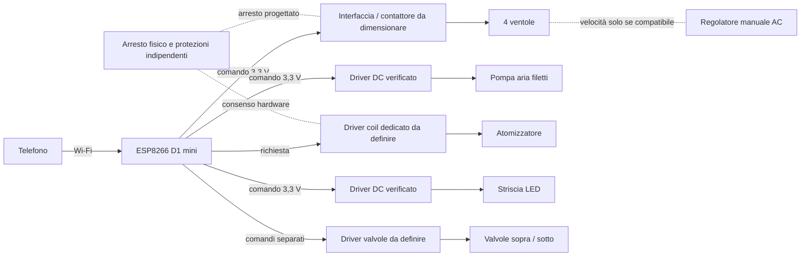

# VENTO — componenti fotografati e prima bozza

Questa bozza si basa sulla foto generale del 16 novembre. Le sigle dei piccoli componenti non sono tutte leggibili. Non è uno schema di collegamento esecutivo.

## I tre componenti richiesti

| Cosa si vede | Identificazione | Possibile uso | Da verificare |
|---|---|---|---|
| Schede blu nella scatola | Probabili moduli di commutazione MOSFET DC | Pilotare pompa DC, LED o valvole DC, se compatibili | Sigla del modulo e dei transistor; morsetti; tensione di ingresso; compatibilità effettiva con GPIO 3,3 V; corrente, dissipazione e protezioni. Non assumere che ciascuna scheda abbia due canali indipendenti. |
| Scheda rossa con due cubetti blu | Modulo con due relè elettromeccanici; sui relè sembra indicata una bobina 5 V | Comandare circuiti separati tramite i contatti | Sigla e scheda esatta; polarità e soglia di comando; ruolo del jumper; isolamento e carico dei contatti. La scritta sui singoli relè non certifica l'intera scheda per rete o carichi motore. |
| Scheda verde con dissipatore e manopola | Sembra un regolatore manuale di potenza AC a controllo di fase, tipo SCR/triac | Possibile regolazione manuale di un carico AC compatibile | Modello e schema del regolatore; tipo delle ventole e compatibilità indicata dal costruttore. La manopola e i suoi fili potrebbero essere a tensione di rete: non collegarli all'ESP né toccarli sotto tensione. |

I MOSFET DC non comandano direttamente la rete AC. Il regolatore con manopola non è automaticamente comandabile da ESP. Un relè può fare ON/OFF ma non è adatto a modulare la velocità con PWM. Non dare per scontato che il jumper della scheda rossa renda l'ingresso compatibile con 3,3 V.

## Altri oggetti nella foto

- Scatola metallica forata: sembra un alimentatore AC/DC. La tensione e la corrente di uscita non sono leggibili. Serve foto della targa, dei morsetti e del selettore di tensione senza alimentazione.
- Scheda verde con grande induttore e dissipatori, a destra: sembra un convertitore DC/DC regolabile. Non è possibile stabilire modello, tensioni o se sia step-down/step-up dalla foto. Non collegarlo alla coil o alla rete finché non è identificato.
- Cavo con modulo nero USB: sembra un convertitore di alimentazione, ma ingresso, uscita, polarità e funzione vanno letti sull'etichetta.
- Confezioni LED COB: verificare tensione e potenza della striscia effettiva e compatibilità con l'alimentatore.

## Prima architettura da verificare

Le frecce mostrano le funzioni. Non mostrano cavi di potenza, terra, interblocco completo, fusibili o morsetti. Per ventole AC l'eventuale regolatore compatibile starebbe nel percorso di potenza; la posizione e la quantità si definiscono sul modello specifico. Il disegno non prescrive un collegamento al morsetto della rete.

Il riscaldatore deve restare senza potenza finché non sono definiti driver, corrente, limitazione, protezione termica indipendente e consenso di flusso. Il timer software non garantisce protezione dal funzionamento a secco. Il firmware attuale è solo una simulazione e non comanda GPIO.

## Cosa fotografare adesso

1. Un modulo blu singolo, fronte e retro: scritte vicino a tutte le viti e sigla sui transistor.
2. Scheda rossa, fronte e retro: scritte dei morsetti, relè, jumper e componente d'ingresso.
3. Regolatore con manopola: sigla e scritte vicino ai morsetti, fronte e retro, senza alimentazione.
4. Targhe delle ventole, pompa e compressore; tensione e potenza dei LED.
5. Coil: resistenza in ohm e potenza raccomandata; alimentatore e liquido.
6. Targhe dell'alimentatore metallico, del convertitore con induttore e del modulo USB nero.

## Prima delle prove

Non collegare rete, coil o carichi ai GPIO. Lascia scollegati i dispositivi durante la lettura delle etichette. La parte a 230 V, le protezioni e la messa a terra richiedono dimensionamento e verifica da personale qualificato. L'aerosol della sigaretta elettronica non è semplice vapore acqueo: verificare fluido, ventilazione ed esposizione dei presenti.

Fonti: [Espressif — logica e avvio ESP8266](https://documentation.espressif.com/esp8266_hardware_design_guidelines_en.html), [ebm-papst — controllo motori AC](https://www.ebmpapst.com/us/en/support/faq.html), [CDC — aerosol da sigaretta elettronica](https://www.cdc.gov/tobacco/e-cigarettes/about.html).
